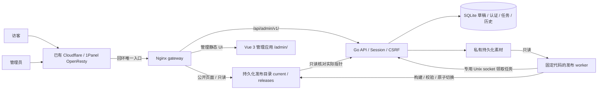

# XiaoWork Homepage V1.1 后台架构（P6-A）

日期：2026-10-26。状态：架构基线与本地骨架；不是后台功能或生产部署验收。

## 1. 现有事实与范围

本轮阅读 P0 规范、确认 PNG、P0～P5 全部交付、进度、内容配置、SEO、Docker 和五份发布脚本。
P0 中“不引入后台/数据库”是 V1.0 边界，本次用户已明确授权 V1.1 扩展，不改写原件。

| 核对项                         | 2026-10-26 实际结果                                                         |
| ------------------------------ | --------------------------------------------------------------------------- |
| 开发基线 / GitHub main         | `14f9b1fba6504b1367aad6165a0b72c37e495927`，起始干净，远端一致              |
| 功能分支                       | `feat/v1.1-admin-p6a`；不自动合并 main                                      |
| 服务器本站源码 / 镜像 revision | `2616ef60e7e9fd7ff6d62d26806bd56673525d52`，checkout 干净                   |
| 服务器实例                     | `xiaowork-homepage:git-2616ef60e7e9`，healthy，restart=0，非 root、只读     |
| 网络                           | 独立 Compose 网络，`127.0.0.1:3100 → 8080`；OpenResty host 模式沿用 P5 实查 |
| 只读 HTTP                      | 首页、项目、关于、health 均 200；本轮未重新访问公网或修改反代               |
| 发布门槛                       | 仍只有内部预览。用户未接受上游 high 风险，不能借后台开发开放公网            |

两项 SHA 不同是因为 main 多了交付文档，不代表运行镜像自动更新。本轮只读核对未执行 fetch/pull、部署、迁移、重启或远程写入。

当前页面从 `app/data/{site,about,projects,project-covers}.ts` 构建时导入；`shared/seo.ts` 与 `server/routes/` 生成三页 SEO/sitemap/robots。Nginx 镜像内嵌 `.output/public`，没有运行时 Node、数据库、管理接口或上传目录。

## 2. 选择：静态前台 + 单管理员 API + 独立发布 worker

公开请求不查询 SQLite 或 API。静态 HTML、hydration 数据、客户端内容、SEO、分享和爬虫文件全部来自同一个快照和已审代码。Go API 只提交有类型的任务，不调用 shell。worker 使用固定可执行文件和参数构建，不接收命令、脚本、源码、依赖版本、输出路径或环境变量输入。

不用 Git 驱动每次内容发布：单人内容修改不需要向 Git 写个人资料/媒体，也不需要在线保存 GitHub 凭据、SSH 私钥、Docker socket 或构建平台 Token。代码和 schema 版本仍经 GitHub 功能分支/测试/正常合并发布。代价是新增一个受限 worker、发布存储、队列恢复和磁盘保留策略；静态发布需要构建等待，保存草稿不会立即影响访客。

不采用整站 SSR，也不采用“客户端取 JSON、搜索引擎仍看旧 HTML”的替代方案。纯模板替换现有 HTML 会破坏 Vue hydration，因此不用字符串替换 SEO/页面。

## 3. 代码边界与组件复用

| 路径                                          | 职责 / 阶段                                                           |
| --------------------------------------------- | --------------------------------------------------------------------- |
| `app/`、`shared/`、`server/routes/`           | 保留前台。P6-D 将数据导出改成快照适配，复用现有组件和导出接口         |
| `backend/cmd/homepage-api/`                   | API 与运维 CLI；P6-A 仅 schema/健康/拒绝管理请求                      |
| `backend/internal/`、`backend/migrations/`    | 持久化、后续 auth/content/media/jobs；显式版本化 SQL                  |
| `admin/`                                      | P6-C 独立 Vue 3 + TS 应用，`/admin/` 基路径；不会进入访客 Nuxt bundle |
| 后续 `publisher/`                             | 固定源码及 lockfile 的 worker；P6-D 实现，当前不运行                  |
| `compose.admin-dev.yaml`、`deploy/admin-dev/` | 独立本地编排，不引用生产 `.env`/`.deploy`                             |
| `docs/architecture/`                          | 数据库、API/安全、发布流程与本设计                                    |

管理 UI 使用既有紫黑/暖白/浅紫令牌、圆角、焦点和 reduced-motion 约定；布局为桌面左侧栏、顶部状态/保存发布区域、右侧内容，手机侧栏变可关闭抽屉。表单默认中文、保存状态清晰、错误聚焦、排序有键盘上移/下移替代拖拽。P6-C 才增加独立 UI 构建依赖并锁定，不复制另一套 Nuxt/大型 UI 或动画框架。

## 4. 内容与模型原则

数据库详见 [数据库设计](V1.1-DATABASE.md)，接口和页面详见 [API/安全设计](V1.1-API-SECURITY.md)。

- 单个 workspace revision 串联项目、分类、个人资料、网站设置和素材引用；写入必须带预期 revision，冲突拒绝，避免双标签页覆盖。
- 草稿中的项目生命周期与 `status` 分开：draft/archived/visible 是编辑控制，`unconfirmed/live/...` 是展示事实；有成功发布记录也不能自动改成“已上线”。
- 发布是整个 workspace 的一致快照。新/修改/归档/隐藏均需明确发布才改变公开站；项目页可显示各项目相对当前成功快照的差异状态。
- 标题/简介/详细介绍采用纯文本段落，不接受 HTML、JS、MDX。详细介绍先用于编辑和预览，V1.1 不顺带引入 `/projects/[slug]` 页面。
- 仅输出可公开字段；禁止把密码哈希、session、内部备注、任务日志、草稿隐藏对象塞进静态 JSON 再靠 CSS 隐藏。
- 固定主域 `https://xiaoworks.com` 和三条页面路径由部署配置/代码控制，不由普通设置表单控制。页面独立 title/description 和默认描述均纳入快照适配。
- 个人资料缺省不显示；公开 GitHub 继续使用已确认本站源码，不推断为三项目源码或个人邮箱。

## 5. 运行与权限拓扑（目标设计，P6-E 才生产验收）

| 服务                   | 读写目录                                    | 网络/权限                                                                           |
| ---------------------- | ------------------------------------------- | ----------------------------------------------------------------------------------- |
| gateway / static Nginx | 发布根只读；管理 UI 在镜像内                | 唯一回环入口，容器 8080；不持有 DB/原始上传                                         |
| Go API                 | DB RW、uploads RW、发布根 RO、UDS目录 RW    | 无宿主映射；仅 gateway 私网可达；不持有发布写权                                     |
| publisher worker       | uploads RO、发布根 RW、工作目录 RW、UDS目录 | `network_mode: none`，经 Unix socket 与 API 通信；无 DB、Docker socket/SSH/Git 凭据 |

API 创建专用 0600 UDS，API/worker 使用相同专用非 root transport UID（10001），通过容器挂载边界隔离权限；这不是不同 UID 隔离。UDS 所在卷不挂到 gateway，Unix 端点不能从 HTTP API 转发。协议仅允许领取一个任务、续租、状态报告和恢复核对，受长度/schema/任务 ID 校验；即便 worker 被攻破也不能经协议读账号表。API 可读实际发布 manifest，不能仅相信 worker 报“成功”。

所有服务只读根、tmpfs、cap drop ALL、no-new-privileges、日志轮转；限制 Go 请求/哈希并发、worker CPU/内存/PID/磁盘额度。DB 必须是本机文件系统，不用 NFS/CIFS；SQLite 不共享给 worker/Nginx。worker 依赖预装在受审镜像中，内容发布时不安装包、不联网、不执行远程脚本。

OpenResty 继续 host 网络 → 站点 gateway 的回环端口。V1.1 切换前在另一空闲回环端口进行独立预演，获生产授权后才只调整本站上游；不复用 NPM、不修改整机 80/443、防火墙、其他网站/DNS。当前本地骨架还没有 worker/发布卷/真实管理 UI，不能据此直接生产升级。

## 6. 持久化、备份与恢复

生产目标是项目外专用目录的 DB、uploads、publications、备份，不能写在 checkout、镜像层或临时容器内；实际主机路径不进公开仓库。开发使用独立命名卷，P6-A 只创建空 schema。

备份一致性流程：暂停写操作/发布/GC并取得全局维护锁 → SQLite Online Backup 或受控 `VACUUM INTO` → `integrity_check`/`foreign_key_check` → 按该快照的全部素材引用和所有保留 release 清单复制不可变文件 → 记录 current、manifest、schema、镜像 digest、代码完整 SHA、校验和 → 加密保存项目外/异地 → 恢复演练。不能只复制运行中的 `.sqlite` 主文件，WAL/SHM 不能随意删除。

恢复到独立目录/新卷，先校验数据库、文件清单、schema兼容和三个静态页面，再显式切换；恢复 DB 会丢失备份后的草稿/账号改动，必须单独确认。不要把内容回滚当作数据库恢复：内容回滚只激活历史成功静态版本，保留当前草稿及管理员会话。

## 7. 现有部署脚本的兼容边界

现有 `release.sh/deploy.sh/update.sh/rollback.sh/deploy/common.sh` 原样保留，用于 V1.0 单 web 镜像；`.deploy/current` 仍表示镜像标签。它们没有管理 API/schema/内容版本的整体发布能力，不能在 Compose 加一个服务后就声称 V1.1 已有安全更新回滚。

P6-E 增加独立 V1.1 代码部署入口与单一原子部署 manifest，记录 gateway/API/worker 镜像 digest、代码 SHA、schema读写兼容范围、内容 manifest。加全局部署/维护锁和 API维护状态，防止与内容切换、备份、迁移并发。schema先做兼容性扩展，严禁自动 destructive/down migration；旧代码不兼容新schema时拒绝镜像回滚，提供独立备份恢复方案。V1.0脚本不接受功能分支直接上线，P6-A不改其main-only检查。

## 8. 迁移步骤与停止条件

1. P6-B 只读导出当前 TS 数据、SEO 与封面白名单，校验 schema 和哈希；JSON不能通过字符串拼代码执行。显式 CLI 一次性导入全空 workspace，并记录来源 SHA/导入摘要；重跑不覆盖已编辑数据。
2. Blog/Nav/ERP 的 ID、顺序、精选、介绍、空技术栈、`unconfirmed`、占位标记和三条独立封面路径全部保留。仓库自有 SVG 占位走固定白名单，不等于开放 SVG 上传。
3. 草稿初始化不改变公开站。P6-D 用导入快照构建初版候选，验证同 P5 页面/截图/SEO/所有入口一致，才获得“可供验收的首个内容版本”。旧 V1.0 镜像及回环实例保持可恢复。
4. 既有站点的代码发布与内容版本映射记录清楚，不能把当前生产目录绑定到本地 DB，也不能在镜像启动时静默重新导入示例覆盖用户数据。
5. 公网门槛未解除、敏感资料、未知现有实例/目录、schema不兼容、磁盘满、健康/恢复失败或影响其他业务不明时停止；不以V1.1为由连接修改生产。

## 9. 阶段计划和实际完成边界

| 阶段      | 工作                                                                   | 必须实际通过的验收                                                 |
| --------- | ---------------------------------------------------------------------- | ------------------------------------------------------------------ |
| P6-A 本次 | 架构/SQL/API/发布/部署/安全设计，隔离Go SQLite骨架                     | schema初始化/重跑/约束、未实现API拒绝、健康、独立Compose、前台回归 |
| P6-B      | 安全初始化账户、认证/CSRF/限速、项目分类CRUD、资料设置、上传引用、导入 | API集成/安全/并发冲突/持久化/恶意图片/注销改密撤销                 |
| P6-C      | 中文Vue管理应用、仪表盘/表单/媒体/排序/主题                            | 键盘/320至1440/双主题/错误和空态；真实API，不做假按钮              |
| P6-D      | 快照适配、worker、私有预览、构建/验证/切换/回滚                        | A→B旧标签页、SEO一致、失败/崩溃恢复、草稿不泄露、旧资源保留        |
| P6-E      | 部署manifest、备份恢复、完整安全/浏览器/Docker/性能检查                | 隔离环境恢复演练与升级回滚；审计和生产预检，另取生产执行授权       |

P6-A不具备登录、CRUD、上传、真实数据迁移、草稿预览或发布能力。数据库设计会随实际实现采用新的迁移演进；不能修改已使用的迁移去伪造兼容历史。

## 10. 参考与风险

本轮只读核对官方 Go release JSON（本机1.27.3）、Go模块代理（modernc SQLite v1.61.0）、SQLite WAL/备份文档、Nuxt配置与本机4.6.2运行时源码、Argon2包文档。原始源码/锁版本仍是验收依据：

- https://go.dev/dl/?mode=json
- https://pkg.go.dev/modernc.org/sqlite
- https://www.sqlite.org/wal.html
- https://www.sqlite.org/backup.html
- https://www.sqlite.org/lang_vacuum.html
- https://pkg.go.dev/golang.org/x/crypto/argon2
- https://nuxt.com/docs/4.x/api/nuxt-config
- https://api.github.com/advisories/GHSA-86w9-cpqp-85rv

SQLite WAL 已知修复基线 >=3.51.3（不采用更老分支回补）；骨架核验驱动实际 `sqlite_version()`，而非宿主sqlite3。发布worker将长期持有Node构建依赖，攻击面比V1.0单次离线构建增加，须隔离网络/输入、锁代码并限制资源；原npm high不能因为Go服务而标已修复。当前风险决定保持，不开放公网。

关联：[发布机制](V1.1-PUBLISHING.md)、[开发环境](../V1.1-DEVELOPMENT.md)、[P6-A交付](../deliveries/P6A-delivery.md)。
