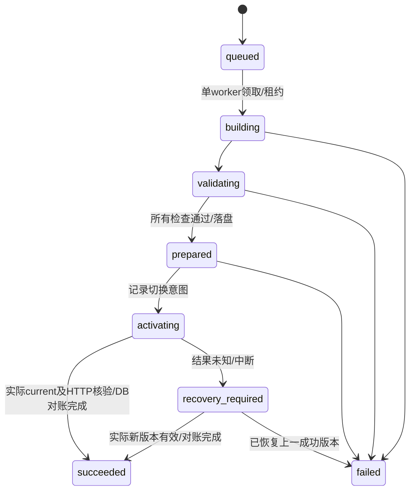

# V1.1 静态内容发布与失败恢复设计

P6-A 设计，P6-D 实现及故障注入验收。当前没有可调用的发布接口/worker，也没有写生产发布目录。

## 1. 一次发布的不可变输入

API在SQLite短事务中校验管理员、CSRF、workspace revision、引用与公开字段，冻结完整快照：

```text
schemaVersion / snapshotId / workspaceRevision / createdAt
siteProfile / aboutProfile / siteSettings / pageSeo
visibleProjects（含排序/精选/分类；无隐私、归档或内部备注）
mediaManifest（媒体ID、规范化文件SHA256、尺寸、MIME、alt、用途）
legacyAssetAllowlist（代码自有占位/品牌资源，不允许任意路径）
```

JSON采用确定性序列化计算SHA256；可执行代码、原始上传文件名、物理路径、会话/密码和原始内部日志不能进入快照。冻结快照后即便继续编辑，任务仍只使用该revision。一个全站发布包括所有未发布变化，UI确认摘要必须列出修改/新增/隐藏/归档，不能暗示只发布某个项目。

同事务插入sealed snapshot、媒体引用和queued job。幂等键防止重复点击；全站至多一个未完成任务（含预览、发布和恢复），冲突409。HTTP返回202与jobId，表示已排队，不表示前台已更新。

## 2. 发布目录和权限

```text
publications/                 # 同一Linux本机文件系统，非NFS
  current -> releases/<id>    # 相对链接，唯一实际active指针
  releases/<id>/
    public/                  # 完整静态HTML/robots/sitemap及版本资源
    manifest.json            # 不公开：内容/代码/构建器/文件哈希/上一版本
  activations/<job-id>/       # 私有：本次意图、验证receipt及恢复记录
  staging/<job-id>/           # 没有任何公开HTTP location
  preview/<preview-id>/       # 只由鉴权网关读取，不能公开静态映射
```

Nginx只读挂载整个发布根，在容器内解析`current`，不能只bind mount `current`的目标（会固定旧目录）。公开root为`/publications/current/public`；版本资源专用受限location将`/_releases/<合法id>/...`映射到`/publications/releases/<id>/public/...`，仅允许`_nuxt`与明确公开资源子树。不能将整个releases、manifest、activations、preview或staging直接autoindex公开。

目录ID由程序产生，固定长度安全字符，不使用用户slug当物理路径。不跟随用户上传symlink，拒绝`..`、分隔符、NUL和转义逃逸；文件必须regular file。API只有发布根RO，worker有RW；gateway无DB/原图、worker无DB、所有应用无Docker socket。

## 3. 状态与激活流程



实现步骤：

1. worker通过专用UDS领取job、sealed snapshot及不可变媒体清单。API校验快照哈希/版本与任务状态，worker同样复验。worker单实例、持有OS发布锁；任务租约用于观测，不能在旧构建尚存活时直接起第二个发布者。重启先对账、停止遗留子进程，才重领。
2. 受审镜像预装固定Nuxt源码、精确lockfile及依赖；把JSON作为数据文件导入快照适配层。固定`exec.CommandContext(node, fixedCLI, fixedArgs...)`，无`sh -c`、无外部命令模板、无运行时npm安装、无动态Git拉取。清空环境，只允许固定主域、releaseId、固定工作/输出目录。超时/资源耗尽杀整个构建进程组并失败。
3. 在staging构建。`NUXT_PUBLIC_SITE_URL=https://xiaoworks.com`；复用现有静态三页。结构化数据/属性用Vue/框架转义，不字符串拼接脚本。worker网络禁用，不抓取用户外链，不载入远程字体/截图/任意插件。
4. 校验完整产物：三页/404/health、页面正文对应快照、独立title/description/canonical/OG、sitemap/robots、所有本地资源/引用/哈希、无草稿/秘密/未知公网链接、版本资源规则、内部导航；静态校验加本机只读临时HTTP测试，不访问生产入口。产生manifest及验证摘要。
5. fsync产物/manifest/父目录，rename staging至不可变releases/id（相同文件系统）。写好previous release、snapshot hash、builder image digest、source SHA、schema、file manifest。API先记录prepared及activation token，确认目标与前一指针符合预期，才准许切换。
6. `current.next.<token>`是程序生成的相对symlink，通过同目录rename原子替换current并fsync父目录。不要先删current，不逐文件复制覆盖当前站。Nginx的open_file_cache对HTML/指针禁用，避免持有旧路径；无需重启OpenResty。
7. worker通过UDS提交本次切换结果，并将本任务独有的验证receipt写到私有`activations/<job-id>/`，不改已封存artifact。API通过RO发布根核对current、manifest、该receipt及任务token/hash，再经仅内网可达的gateway核验版本标识、三页/SEO/资源，提交本次对账结果和succeeded。无网络worker只执行步骤4的本机候选校验，不访问gateway。UI轮询得到成功时还展示实际active ID；状态不一致显示“恢复处理中/需检查”，不显示成功。

DB、current和私有receipt之间没有共同原子事务。FS current是当前实际站点的事实，DB保存任务与审计。receipt先以临时文件加fsync/rename持久化；current与receipt之间任一崩溃都按实际指针、数据库意图和HTTP对账，不能把另一个文件存在当成切换已完成。即使文件已切换但DB写失败，也不能提示失败后直接重发：先进入recovery_required，对账后决定完成或恢复。不存在“DB的published=true就当网站成功”的路径。

## 4. 每个失败点的恢复

| 故障位置                    | 实际公开版本       | 必须行为                                                                                   |
| --------------------------- | ------------------ | ------------------------------------------------------------------------------------------ |
| 快照事务/排队失败           | 旧版               | 事务回滚，无任务成功；不碰current                                                          |
| 构建/校验/超时/磁盘不足     | 旧版               | 标failed并保留脱敏摘要；不动旧版；临时文件定向清理                                         |
| prepared后、rename前崩溃    | 旧版               | 启动核验prepared和旧指针后安全重试或failed；不得并发重构建                                 |
| rename后DB未完成/worker断开 | 可能新版           | 锁住新激活，对照意图/current/token/hash和HTTP；成功补记或恢复旧指针                        |
| 新版HTTP核验失败            | 可能短暂新版       | 同样原子恢复上一成功目录并验证，job仍failed；恢复也失败则maintenance/recovery_required报警 |
| DB不可用                    | 已激活静态页仍可读 | API503/no-store，禁止新任务/切换，不猜测任务成功                                           |
| 机器/文件系统故障           | 不承诺可用         | 从受限备份和保留镜像恢复；不能声称单机零停机或断电绝对无损                                 |

静态切换不重启容器，正常切换无需停站；并发请求可能分别看到完整A或完整B，不能承诺全球浏览器/CDN同一毫秒切换。失败后的短暂新版本曝光可发生，验证前预览、禁缓存HTML和快速恢复用于缩小范围。Cloudflare对HTML、管理/API、preview必须绕过缓存，不能缓存Everything后还保证即时发布；规则调整必须等独立生产授权，不能为本站改全区其他站规则。

## 5. 防止HTML、bundle与payload混合

Nuxt 4.6.2本机schema/runtime确认有`experimental.payloadExtraction=false`。P6-D显式关闭公开站路由payload提取，避免旧标签页导航请求current的新`_payload.json`；快照编入该次构建bundle，旧客户端内部导航保持旧快照，刷新才进入当前快照。不得仅关闭SSR或让访客改为运行时API取数据。

`app.baseURL`保持`/`，canonical始终固定三条正式页面URL。每次构建设置版本化`buildAssetsDir=/_releases/<id>/_nuxt/`，该目录由保留历史版本的独立location读取，切换后旧JS/CSS/chunk仍可访问。构建检查所有chunk引用均使用该前缀，不能只改HTML入口。若Nuxt升级破坏此约定，阻断发布，不能回退成混合版本。

所有public资源也要处理：

- 上传图片：SHA256命名/只含重编码后的公开衍生图，复制到该release的公开资源树并复验哈希，不公开uploads原目录。禁止普通硬链接，避免跨挂载失败及可写inode反向改变私有素材；改图得到新URL。
- 自有占位、主题恢复脚本、favicon、默认分享图：每版复制到版本前缀并在Nuxt head/SEO/封面适配中引用；不能仍随current可变。既有根路径仅作明确兼容映射，新HTML不依赖可变根路径。
- 预留错误页/health/version标识；关闭Nuxt app-manifest的未版本化刷新入口或将其纳入版本前缀，禁止意外在线读取current的数据。实现时以实际网络请求验收，不能只检查配置。
- 新session全部B，旧已打开A及其路由仍A，刷新B，回滚A；这是明确的可解释更新语义。可提示“内容已更新，请刷新”，但不强制切换进行中的操作。

保留所有被当前/上一成功版本、成功历史、预览/任务、备份引用的媒体。V1.1默认不自动清理成功release和其资源；仅清理过期失败staging/已失效preview。后续有容量需要再做保留政策和离线归档，不能用短TTL删除仍被旧页面或备份引用的文件。内容版本不可删到无法回滚却仍展示“可恢复”。

## 6. 草稿预览

预览是同一sealed snapshot、同一固定构建器的独立任务，放私有preview目录，不切current、不标已发布。只允许登录管理员经 `/api/admin/v1/previews/<id>/...` 访问；每个HTML/chunk/图片请求均鉴权、no-store、noindex，未登录拒绝，不使用可分享的查询Token。

预览有受控baseURL/资源前缀（不同于正式构建），不得让绝对`/images`等路径落入公开树；manifest/canonical保持正式目标用于检查，但HTTP另加noindex。未经过处理的上传仍不得进入预览。使用短TTL、数量和构建额度限制，退出/到期后停止访问。

点击发布同一revision时按正式`/`路由和正式资源规则重新构建并验证，不能把带预览路由或noindex的目录直接提升为正式版。预览失败与正式发布失败分别记录，不影响现有站点。

## 7. 内容回滚与代码升级

内容回滚选择“上一成功且完整保留”的release，提交独立rollback job，校验manifest/hash/所有媒体、代码内容格式兼容及三页HTTP后走同一prepared/activation/verify流程。每次恢复产生自己的activation token和`activations/<job-id>/`记录，不能复用旧任务的成功proof或修改旧release目录；API重新核验实际current及HTTP。不重编译旧内容、不修改草稿、不恢复旧数据库/账号、不把历史job状态改写。页面明确“恢复公开版本，不覆盖当前草稿”；另设显式“复制历史内容到草稿”动作才修改草稿revision。

每版记录生成器完整源码SHA、builder镜像digest、快照/内容schema、文件哈希。代码部署时校验旧静态产物兼容和API schema范围，必要时先生成新候选；gateway/API/worker更新与内容发布共用维护锁。旧成功静态页面可在API维护时继续服务。

V1.0的`.deploy/current`和`rollback.sh`仍是镜像回滚；V1.1 `publications/current`和管理历史是内容回滚。两者不能共用文件、混称或自动回退数据库。

## 8. P6-D/E 必测项

- 保存草稿/隐藏/归档后公开HTML、SEO、bundle与图片均不变化；发布快照不含不可公开字段。
- 创建A→打开A标签页→发布B→A内部导航/懒加载仍A→刷新全B→回滚全A；检查实际网络及SEO，不只肉眼。
- 并发publish、重复幂等键、多标签页revision冲突；完整重排序事务。
- 构建失败、坏SEO/缺媒体、磁盘满、超时、worker kill、每个激活步骤崩溃、DB提交失败、恢复再次失败；检查HTTP/current/job三者。
- 认证预览的所有子资源、退出、TTL、路径穿越、未登录及搜索引擎头；正式版不带preview/noindex。
- 内容回滚后草稿不丢；schema不兼容拒绝程序回滚；备份在新卷实际恢复。
- 真实封面/资料到齐后重跑性能和双主题/五档响应式，与P5同环境基线比较；原npm high门槛未解除时不公开发布。
